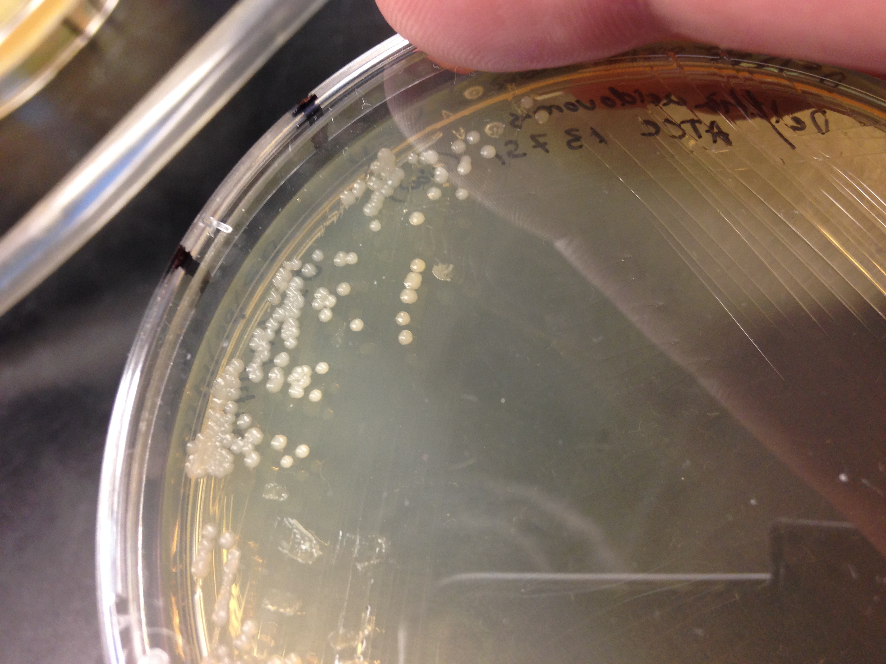
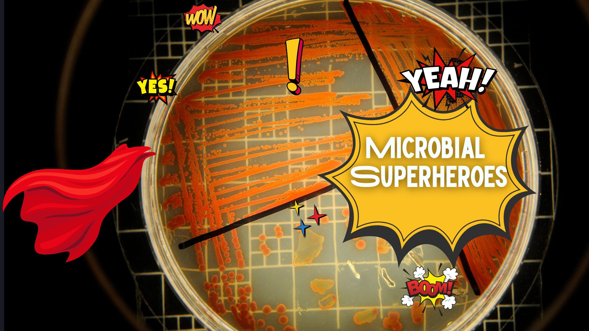
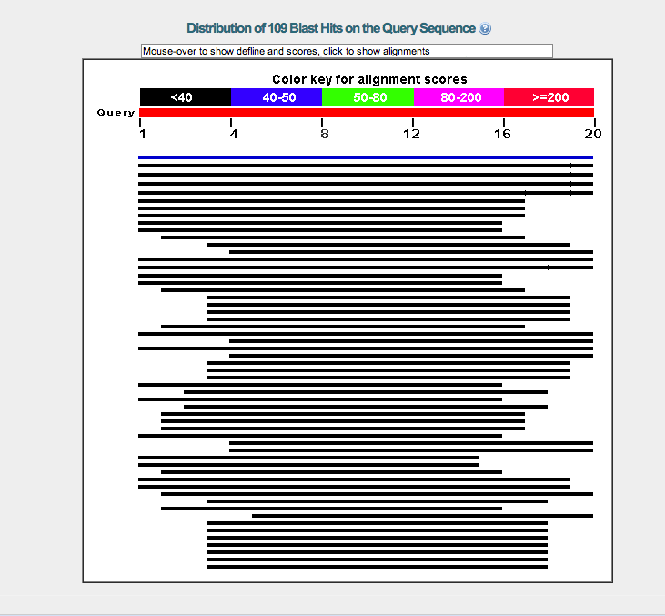

```{=html}
<!-- ===== HERO ===== -->
<section class="hero-section" aria-labelledby="hero-heading">
  <h1 id="hero-heading">The Delftia Project</h1>
  <p class="hero-subtitle">
    Unlocking the secrets of <em>Delftia acidovorans</em> — a remarkable bacterium
    that biomineralizes gold, thrives in toxic environments, and holds promise for
    bioremediation and biotechnology.
  </p>
  <div class="hero-actions">
    <a href="about.html#get-involved" class="btn-hero btn-primary-hero">Get Involved</a>
    <a href="#research-highlights" class="btn-hero btn-outline-hero">Explore Research</a>
  </div>
</section>

<section class="discover-delftia" role="region" aria-labelledby="discover-heading">
  <div class="discover-intro">
    <h2 id="discover-heading">Discover <em>Delftia</em></h2>
    <p><strong>Tiny microbes. Big impact.</strong> <em>Delftia</em> bacteria are found in soil,
      water, plant roots, and engineered environments. Scientists study them
      because of their remarkable environmental versatility and unusual
      biochemical capabilities.</p>
  </div>
  <p class="discover-tagline">From microscopic genomes to environmental innovation,
    <em>Delftia</em> demonstrates how tiny organisms can have an outsized
    impact on our planet.</p>
  <div class="card-grid discover-grid">
    <article class="feature-card discover-card" aria-labelledby="discover-genus">
      <div class="discover-stat">1999</div>
      <h3 id="discover-genus">A New Genus</h3>
      <p>The bacterial genus <em>Delftia</em> was established in 1999,
        giving these versatile microbes a name of their own.</p>
      <details>
        <summary>Explore the name</summary>
        <div class="discover-details">
          <p><em>Delftia acidovorans</em> was previously classified as
            <em>Comamonas acidovorans</em>. The new genus was named after
            Delft, the Dutch city associated with its early isolation.</p>
        </div>
      </details>
      <p class="discover-source">Source: <a href="#discover-ref-genus">Genus description (1999)</a></p>
    </article>
    <article class="feature-card discover-card" aria-labelledby="discover-genome">
      <div class="discover-stat">6.27 Mb</div>
      <h3 id="discover-genome">A World Inside a Genome</h3>
      <p>The draft genome of <em>D. tsuruhatensis</em> MTQ3 contains
        about 6.27 million DNA base pairs.</p>
      <details>
        <summary>Explore the genome</summary>
        <div class="discover-details">
          <p>MTQ3 was isolated from the tobacco rhizosphere—the soil around roots.
            Its genome helps researchers ask how bacteria interact with plants.
            This is one strain, not a genome size shared by every <em>Delftia</em>.</p>
          <p><a href="dashboard-genome-comparison.html">Compare two published genomes</a></p>
        </div>
      </details>
      <p class="discover-source">Source: <a href="#discover-ref-genome">MTQ3 genome report (2015)</a></p>
    </article>
    <article class="feature-card discover-card" aria-labelledby="discover-gold">
      <div class="discover-stat">2013</div>
      <h3 id="discover-gold">Turning Gold Toxicity into Opportunity</h3>
      <p>Scientists reported how a molecule from <em>D. acidovorans</em>
        helps turn dissolved gold into solid particles.</p>
      <details>
        <summary>Explore gold biomineralization</summary>
        <div class="discover-details">
          <p>Delftibactin protects the bacterium from toxic dissolved gold by
            promoting its precipitation. The gold changes form—it is not created
            from nothing. This laboratory finding is not proof of safe,
            economical recycling of mixed electronic waste at industrial scale.</p>
          <p><a href="research.html">Discover our research projects</a></p>
        </div>
      </details>
      <p class="discover-source">Source: <a href="#discover-ref-gold">Delftibactin study (2013)</a></p>
    </article>
    <article class="feature-card discover-card" aria-labelledby="discover-community">
      <div class="discover-stat">2025</div>
      <h3 id="discover-community">Discovery for Everyone</h3>
      <p>“Where is <em>Delftia</em>?” brings citizen science into
        biotechnology and environmental science curricula.</p>
      <details>
        <summary>Explore citizen science</summary>
        <div class="discover-details">
          <p>Students and communities can ask questions about microbes in their
            surroundings, investigate scientific literature, and share what
            they learn. The project connects classroom learning with real research.</p>
          <p><a href="learn.html">Find learning resources</a> or
            <a href="about.html#get-involved">get involved in the project</a>.</p>
        </div>
      </details>
      <p class="discover-source">Source: <a href="#discover-ref-community">Citizen science publication (2025)</a></p>
    </article>
  </div>
  <div class="discover-sources" aria-labelledby="discover-sources-heading">
    <h3 id="discover-sources-heading">Explore the Sources</h3>
    <ol>
      <li id="discover-ref-genus"><em>Delftia</em> Wen et al. 1999.
        <a href="https://lpsn.dsmz.de/genus/delftia">Genus record in the List of Prokaryotic names with Standing in Nomenclature</a>.</li>
      <li id="discover-ref-genome">Hou et al. (2015).
        <a href="https://pubmed.ncbi.nlm.nih.gov/26251486/">Draft genome sequence of <em>D. tsuruhatensis</em> MTQ3</a>.</li>
      <li id="discover-ref-gold">Johnston et al. (2013).
        <a href="https://doi.org/10.1038/nchembio.1179">Gold biomineralization by a metallophore from a gold-associated microbe</a>.</li>
      <li id="discover-ref-community">Spence et al. (2025).
        <a href="https://doi.org/10.1128/jmbe.00088-24">Where is <em>Delftia</em>? Implementing citizen science into the biotechnology and environmental science curriculum</a>.</li>
    </ol>
  </div>
</section>

<!-- ===== STATS BAR ===== -->
<section class="stats-bar" aria-label="Project statistics">
  <div class="stats-grid">
    <div class="stat-item">
      <div class="stat-number" aria-hidden="true">4</div>
      <div class="stat-label"><span class="visually-hidden">4 </span>Publications</div>
    </div>
    <div class="stat-item">
      <div class="stat-number" aria-hidden="true">13</div>
      <div class="stat-label"><span class="visually-hidden">13 </span>years of <em>Delftia</em> research</div>
    </div>
    <div class="stat-item">
      <div class="stat-number" aria-hidden="true">3</div>
      <div class="stat-label"><span class="visually-hidden">3 </span>Research Initiatives</div>
    </div>
  </div>
</section>
```

## What is *Delftia acidovorans*? {#about-delftia}

::: {.research-spotlight}
::: {.research-spotlight-text}
*Delftia acidovorans* is a gram-negative, non-fermentative bacterium first identified in Delft, Netherlands, in soil enriched with acetamide. It thrives in habitats containing high concentrations of heavy metals — copper, cobalt, and even **gold** — and produces a nonribosomal peptide that allows it to precipitate gold out of solution, avoiding toxicity.

Today, *Delftia* is found in waste-contaminated soil, water systems, and drains. Beyond its remarkable environmental capabilities, it is studied as an opportunistic pathogen and explored for applications in:

<span class="tag-chip"><span aria-hidden="true">🏅</span> Gold Biomineralization</span>
<span class="tag-chip"><span aria-hidden="true">♻️</span> E-Waste Recycling</span>
<span class="tag-chip"><span aria-hidden="true">🌿</span> Bioremediation</span>
<span class="tag-chip"><span aria-hidden="true">🧬</span> Genomics</span>
<span class="tag-chip"><span aria-hidden="true">🔬</span> Undergraduate Research</span>

<br/><br/>
<a href="references.html" class="btn-hero btn-primary-hero btn-hero--compact">View Publications →</a>
:::

{fig-alt="Colonies of Delftia acidovorans on agar" .spotlight-image}
:::

---

```{=html}
<!-- ===== RESEARCH HIGHLIGHTS ===== -->
<section id="research-highlights" class="section-alt research-highlights" aria-labelledby="research-highlights-heading">
  <div class="research-highlights-inner">
    <h2 id="research-highlights-heading" class="section-title">Research Highlights</h2>
    <p class="section-subtitle">Three pillars of the Delftia Project — from the classroom to the community</p>
    <div class="card-grid">

      <div class="feature-card">
        <div class="card-icon" aria-hidden="true">🎓</div>
        <h3>Undergraduate Research</h3>
        <p>
          Students in MB 360 and LSC 170 engage in hands-on course-based research experiences —
          growing <em>Delftia</em> in the lab, analyzing spot plates, and dissecting
          "Microbial Superheroes" publications.
        </p>
      </div>

      <div class="feature-card">
        <div class="card-icon" aria-hidden="true">🤖</div>
        <h3>Genomics &amp; Automation</h3>
        <p>
          High-throughput sequencing and automation tools help us decode the genome of
          <em>Delftia</em>. BLAST analyses, bioinformatics pipelines, and cloud computing
          accelerate discovery.
        </p>
      </div>

      <div class="feature-card">
        <div class="card-icon" aria-hidden="true">🌐</div>
        <h3>Citizen Science</h3>
        <p>
          Community annotators collaborate via Hypothes.is to mine the scientific literature
          on <em>Delftia</em> as a pathogen, gold-biomineralizing agent, and e-waste recycler.
        </p>
      </div>

    </div>
  </div>
</section>
```

## Lab Gallery

::: {.gallery-grid}
::: {.gallery-item}
{fig-alt="Laboratory spot plate with Delftia colonies"}

**Spot Plate — 48 hrs**  
*MB 360 course-based research*
:::

::: {.gallery-item}
{fig-alt="LSC 170 students analyzing Delftia publications"}

**LSC 170 — Microbial Superheroes**  
*Publication analysis workshop*
:::

::: {.gallery-item}
{fig-alt="BLAST results for Delftia reverse primer"}

**BLAST Analysis**  
*Reverse primer sequence search*
:::

::: {.gallery-item}
{fig-alt="DELFTIA citizen science graphic"}

**Citizen Science**  
*Community annotation project*
:::
:::

---

```{=html}
<!-- ===== CALL TO ACTION ===== -->
<section class="cta-section" aria-labelledby="cta-heading">
  <h2 id="cta-heading">Interested in Joining the Delftia Project?</h2>
  <p>
    Whether you are an undergraduate student, educator, or citizen scientist —
    there is a place for you. Help us uncover the biology and applications of
    one of nature's most fascinating microbes.
  </p>
  <a href="about.html#get-involved" class="btn-hero btn-primary-hero">Get Involved Today</a>
  <a href="news.html" class="btn-hero btn-outline-hero">Explore Student Projects</a>
</section>
```
